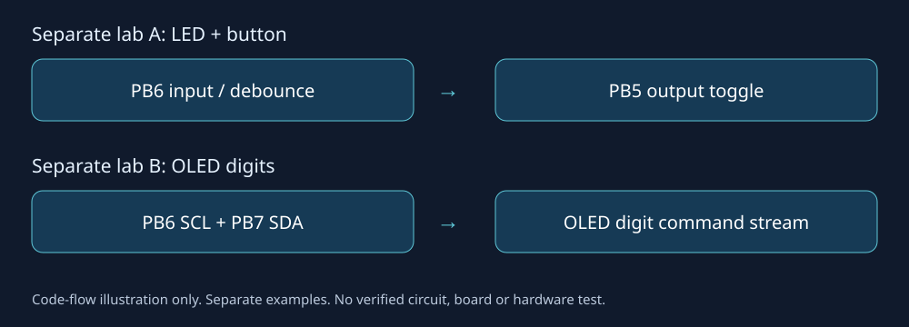

# STM32F103 · 课堂练习归档

两个同源Keil课堂目录的源码保全与小范围构建整理：一个练习按键消抖后切换LED输出，另一个通过GPIO模拟I²C向OLED发送“2026”数字。保留原始课堂版本，另外提供尽量少改动、实际编译链接通过的示例。



**状态：WIP，软件构建已验证，硬件未验证。** 没有启动EDA/CubeIDE、连接或烧录实板，也没有重做电路设计。两例占用的PB6含义不同，应分别使用，不能把此图当成可直接制造或接线的设计。

## 保全了什么

| 路径 | 内容与边界 |
|---|---|
| classroom/led-key/ | 原LED/按键main、独立PA0 LED旧模块、Keil工程，原字节保全 |
| classroom/oled-digits/ | 原OLED main、delay、key备用main、LED模块、局部字模草稿、Keil工程，原字节保全 |
| examples/ | 最小修正版main、复用并初始化的delay、独立Keil项目 |
| patches/ | main/delay改动补丁，便于对照原课堂代码 |
| dependencies/ | 62个外部SDK/模板文件的SHA-256与官方获取入口；不含厂商源码 |
| references/cubeide-hh/ | 另一个STM32C011零业务初始化ioc，明确与F103例子区分 |
| tools/ | 校验/恢复外部依赖、纯软件编译链接工具，不烧录 |

原两目录共342文件逐一盘点：12个本地源码/Keil项目快照公开，124次厂商文件对应62个独立依赖，202个IDE用户设置/调试状态/生成文件排除，另外4次重复的独立OLED.c/h因精确来源许可未明且缺OLED_Font.h留在本地。它们不是本例active main所用的内嵌OLED实现。完整分类和原件SHA留在私有迁移审计。

## 环境与运行

这是固件源码，没有浏览器成品。准备Python3.9+、合法可用的Arm Compiler6工具链（含armclang/armasm/armlink），以及自行获得的STM32F10x Standard Peripheral Library3.5.0/CMSIS文件。实际验证工具：Windows、Python3.12、Arm Compiler6.9（MDK Plus5.25）。工具链注册/许可文件不在仓库，不提供授权绕过。

1. 从[ST官方STSW-STM32054页面](https://www.st.com/en/embedded-software/stsw-stm32054.html)获得原版本，并查看其自身协议；也可使用自己现有且有权使用的原课堂SDK目录。当前下载权限、登录及完整原包字节未由本项目替你完成。
2. 在仓库根恢复外部依赖：

```powershell
python tools/restore_sdk.py --source C:/path/to/STM32F10x_StdPeriph_Lib_V3.5.0
```

工具按文件名搜索，再逐一核对清单SHA，全部符合才复制到被Git忽略的external/STM32F10x。用本机原课堂目录已实际恢复62/62、全部SHA一致。官方包若与本机历史副本有换行/内容差异，会明确停止；先核对版本、许可和内容，确需使用不同字节时可显式传`--allow-compatible-mismatch`，此时原构建验收不再覆盖那些不同依赖。没有自动下载、静默换库或把缺依赖伪装成功。

3. 纯软件构建两例：

```powershell
python tools/build.py --toolchain C:/Keil_v5/ARM/ARMCLANG/bin
```

也可加`--lab led-key`或`--lab oled-digits`。工具编译C、汇编原厂启动文件，并链接ELF/AXF；日志、map和结果在build/，均不提交。它不枚举调试器、连接开发板或烧录。

Keil用户可打开examples下对应project.uvprojx；已配置Armclang6、STM32F10X_MD、微库和相对依赖路径，但本次只做XML检查与上述CLI构建，未做µVision图形界面验收。原classroom工程为历史快照，依赖文件已剥离，且本身有错误，不是直接运行入口。

## 明确修正与仍有缺口

- LED例：纠正不存在的Device/Include头路径、GPIOB_Pin_5拼写；main先初始化Delay。原main自带LED_Init，与旧PA0 LED.c重名，修正版只选择main内PB5实现，没有把两个模块混编。
- 延时：从另一个原课堂目录复用delay，显式启动24位SysTick核心时钟轮询，不开SysTick中断；补stdint声明与头文件大小写。没有用伪delay或重写大半项目。
- OLED例：0x78已是写地址字节，去除再次左移；PB6/7改开漏输出。实际上是否有上拉、屏型号/地址、时钟、电源与连线尚未知。ACK返回没有完善的上层错误处理，字模与页面布局未实屏验证，不能据“链接成功”认定能正确显示。
- 旧CMSIS早于Armclang，通过显式__INLINE=inline与__DSB到Arm内置屏障函数的编译宏兼容；厂商文件原字节未改。原启动/系统文件的时钟假设仍在，具体晶振与板级时序待核对。
- deepseek_c_20260815_621051.c是原局部字模草稿，并非完整ASCII字体；旧key.c也自带main，仅作课堂变体保全，不纳入同时链接。

2026-10-26实际结果：两例共14个编译/汇编/链接步骤退出0，链接布局与大小记录见[VALIDATION.md](VALIDATION.md)。无实板、仿真或示波器/逻辑分析仪证据；后续先补板型/外设/许可资料，再在用户授权的硬件任务中验收。此次归档不能据以删除本地原工程。

## 来源与许可

本机课堂增量、最小整理代码与工具采用[MIT](LICENSE)；不将ST/CMSIS、工具链、模板或来源未明的独立OLED驱动纳入根MIT。外部范围与缺口见[THIRD_PARTY_NOTICES.md](THIRD_PARTY_NOTICES.md)，更改见[CHANGELOG.md](CHANGELOG.md)。
